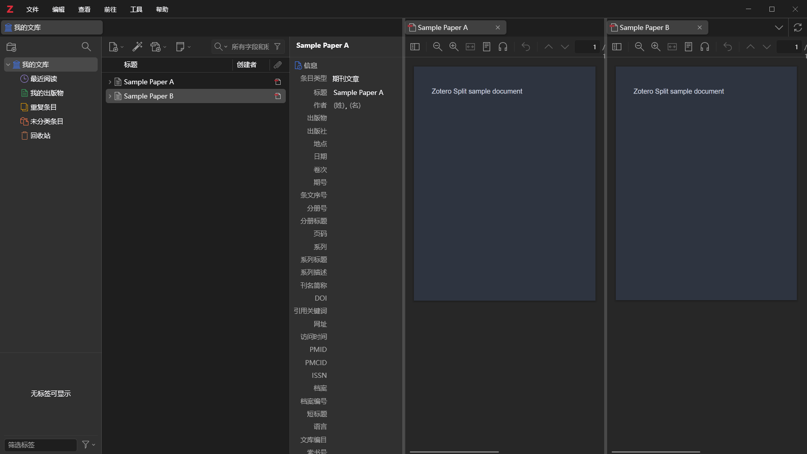
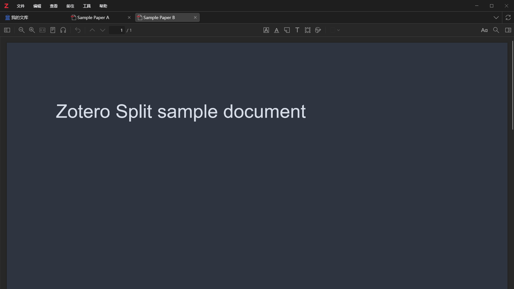

# Zotero Split

将 Zotero 10 的原生标签页拖成可调整大小的分栏。文献库、PDF 阅读器和插件标签页可以并排显示；标签页仍由 Zotero 管理。

## 安装

从 [Releases](https://github.com/liuuang/zotero-split/releases) 下载 `zotero-split.xpi`，在 Zotero 的「工具 → 插件」中选择从文件安装。当前版本面向 Zotero 10。

## 使用

- 把标签拖到内容区的左、右、上、下边缘以拆分窗格。
- 把分栏标签拖到另一窗格的标签栏上以合并；拖到标签上可调整顺序，拖到空白处可追加。
- 拖动分隔线调整大小。点击分栏标签可切换该窗格内容，点击关闭按钮可关闭标签。
- 标签栏放不下所有标签时，把鼠标移到标签栏上滚动即可查看其余标签。
- 合并回单窗格时，Zotero 原有标签栏自动恢复。停用插件或关闭窗口也会恢复原布局。

## 截图与示例

以下截图来自独立 Zotero 测试环境，使用演示文献，不包含个人文献库数据。

### 文献库与两篇 PDF 并排阅读



1. 打开文献库中的两篇 PDF，分别用于阅读与对照。
2. 回到文献库，把第一篇 PDF 的标签拖到内容区右边缘，看到蓝色落点预览后松手。
3. 把第二篇 PDF 的标签拖到右侧窗格的右边缘，形成三栏。
4. 拖动两栏之间的分隔线，为需要仔细阅读的论文留出更多空间。

文献库、PDF 和插件页面不是固定位置，可以按需要交换。需要边读边整理图谱时，也可以将其中一篇 PDF 换成 ResearchGraph 标签页。也可以拖到内容区上、下边缘，形成上下分栏。

### 拖回合并，恢复单栏



把一个窗格的标签拖到另一个窗格的**标签栏**，即可并入该窗格。标签栏空白处也能接收标签；源窗格移走最后一个标签后会自动收起。继续合并，最终恢复 Zotero 原生单栏标签页。

| 想做什么 | 拖到哪里 |
| --- | --- |
| 拆出新窗格 | 内容区的左、右、上、下边缘 |
| 合并到已有窗格 | 目标窗格的标签栏 |
| 调整标签顺序 | 标签栏内目标标签的位置 |
| 调整窗格大小 | 两个窗格之间的分隔线 |
| 取消本次拖动 | 按 Esc |

## 当前限制

- 分栏布局仅在当前窗口会话中生效，不保存为下次启动的布局。
- 插件依赖 Zotero 10 的内部标签页 DOM；其他 Zotero 版本及所有第三方标签插件组合尚未覆盖测试。

## 开发与测试

需要 Node.js 22.8 或更新版本、npm 和 Zotero 10。复制 `.env.example` 为 `.env`，填写独立的 Zotero 开发 profile 和 data 目录。`.env`、测试数据和构建缓存不会提交。

```bash
npm install
```

```bash
npm run build
```

构建产物在 `.scaffold/build/zotero-split.xpi`。运行真实 Zotero 的临时配置测试：

```bash
npm run test:zotero
```

测试使用临时 profile、自生成 PDF 和独立 HTTP 端口 23249；每次最多运行 180 秒，日志保存在 `.scaffold/logs/`。设置 `RG_XPI_PATH` 可额外验证与本地 ResearchGraph XPI 的分栏兼容性。

## 许可

本项目源代码按 [AGPL-3.0-only](LICENSE) 发布。遵守 AGPL 条件即可商业使用；需要不同许可条款的组织可参阅 [商业许可说明](COMMERCIAL_LICENSE.md)。第三方组件和 Zotero 的权利见 [第三方声明](THIRD_PARTY_NOTICES.md)。
